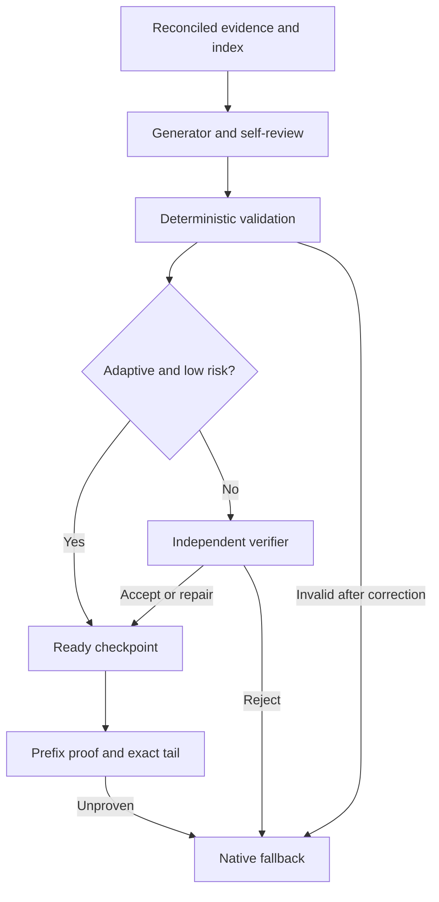

# Claude Shadow Compact

A Claude Code **mod** (plugin of function hooks) that ports
[pi-shadow-compact](https://github.com/sij0sh/pi-shadow-compact) to
Claude Code. It is a real compactor, not a hooks-plus-context shim:
when compaction fires, Shadow answers with a **checked structured
checkpoint plus the exact recent tail** (original messages carried by
their engine handles, untouched), instead of Claude's native summary.

## Native vs Shadow

Native compaction writes a prose summary of what it saw. Shadow writes a
checked checkpoint: every claim points at saved session entries, tested work
is marked verified, untested work stays unverified, and the checkpoint names
exactly how far it covers. By default an independent verifier checks every
draft. Opt-in `verificationMode: "adaptive"` allows eligible low-risk drafts
to publish after deterministic checks and integrated self-review; high-risk
drafts still require independent verification. Failed quality checks fall
back to native compaction.

The example is synthetic and shows the same session on each side, so
compare shape, not size. Task and paths are generic on purpose.

<div align="center">


</div>

| Area | Native | Shadow |
|---|---|---|
| Grounding | Prose, no links | Each claim cites entries (`E0004` ...) |
| Tested vs untested | Same voice | `[verified]` vs `[unverified]` ledger |
| Resume pointer | Buried in prose | Goal, approach, next step |
| Coverage proof | None | `coverageEndEntryId` in live transcript |
| Failure mode | Always installs prose | Falls back to native when unsafe |

<details>
<summary>Text version of the example</summary>

Synthetic session — add CSV export (`src/notes/export.ts`). Left column:
what native prose provides per area. Right column: the Shadow checkpoint.

```text
Native: "Add CSV export to notes app. Updated export logic and wired
the button. Tests were run and things look good. Remaining work
is handled. See prior files for details."

Shadow:
## Objective
- Add CSV export, UTF-8 + commas [E0004]
## Constraints
- Keep JSON export working; bundle size stays flat [E0006]
## Completed Work
- Serializer written; Export button wired [E0012]
## Current State
- Serializer done; Excel import untried [E0023]
## Decisions
- RFC-4180 quoting, not ad-hoc escaping [E0015]
## Open Issues
- Excel import of quoted commas not tried [E0031]
## Next Actions
- Open output in Excel, then merge [E0031]
## Critical Context
- Export path: export.ts via export-button.tsx [E0004]
## Modified Files
- src/notes/export.ts, src/notes/export-button.tsx [E0012]
## Referenced Files
- tests/notes-export.test.ts, 14 passed [E0023]
## Verification State
- [verified] export tests, 14 passed [E0023]
- [unverified] Excel import not tried [E0031]
## Continuation
- Goal: ship an export Excel opens cleanly
- Approach: verify in Excel, then merge
- Next: open notes.csv in Excel
Coverage through E0031. Builder + verifier; fails closed to native.
```
</details>

## How it works



- **Evidence archive and reconciliation.** Every main-loop `session.append`
  row is sanitized and archived under its stable identity. Session initialization
  and canonical history reads are serialized; empty and failed reads remain
  retryable, and an append racing a read causes another read before committing
  the index. Preparation requires reconciled history. Missing old rows are
  rebuilt in canonical order, with the superseded archive saved separately.
  A normal Shadow install retains original evidence for later grounding.
  Canonical reads reaching Claude's 4,096-entry cap are refused; the complete
  live compaction input provides the recovery snapshot instead.
- **Generate → validate → route.** Each Claude role runs in its own bundled Node worker
  launching `claude --safe-mode --print`, using existing Claude authentication.
  Safe mode disables installed plugins, user hooks, CLAUDE.md, skills and other
  customizations (managed policy still applies); only Read/Grep tools are offered. The child runs from the
  frozen evidence directory, with parent-session routing removed and no
  session persistence. It never creates a parent-facing subagent or delivers
  maintenance JSON into the main conversation. A nonce-tagged result file is
  written atomically; stdout contains short status metadata only. Strict JSON,
  evidence references, coverage and continuation state are validated with
  one bounded generator correction. The generator includes a claim-by-claim
  self-review. Deterministic validation checks schema, continuation, known refs,
  coverage monotonicity, forward citations and final size, not semantic truth.
  Adaptive routing is conservative: counts, completion/success/acceptance claims,
  corrections, rejected approaches, errors, truncation and missing user-context
  citations require independent verification. The default `always` policy
  retains the independent verifier for every draft.
  If a worker transport fails, `model.complete` can retry with at most
  120,000 characters of inline evidence. Structured and legacy text completion
  results are normalized. Both Pi and Claude drafts survive verifier transport
  failures, so only verification is repeated. An `unusable` verdict is terminal
  and cannot be retried on another backend for acceptance.
- **Evidence navigation.** Cached turns, manifests, full-text projections and
  an `evidence-index.json` provide row locations and risk hints. The manifest
  includes contiguous inspection ranges, including turns spanning prior coverage.
  Index entries do not establish claim support. Truncated rows retain provenance
  and require independent verification; the existing row-text cap is unchanged.
- **Prefix proof and exact tail.** A checkpoint records its session, history
  epoch, snapshot ID, covered message count, covered-prefix SHA-256 digest,
  and evidence digest. Installation checks the entire covered prefix, including
  tool inputs and result IDs/content/error flags. Handles remain opaque; a full
  content match supports a host changing them. **Every message after the
  checkpoint boundary survives**, even if hundreds of rounds arrived while it
  prepared. The tail starts at the earlier of the round containing the first
  uncovered message and the configured `recentTurns` minimum. Recent covered
  rounds may overlap the checkpoint. Original engine handles keep the tail's
  full blocks intact, and no tool result is separated from its call. A
  candidate must shrink the context. `precompute` compactions are skipped.
- **Checkpoint-first gate and recovery.** An in-flight preparation is held
  until it succeeds or fails. When coverage is missing or the prefix changed,
  the hook freezes the complete `e.messages` input, invalidates an incomplete
  checkpoint, and runs one recovery preparation. It does not merely relabel
  unknown handles: the replacement checkpoint must summarize the repaired
  evidence. Existing preparation, recovery, worker retries and fallback all
  share the original deadline. The hold uses short host `sleep` processes,
  because the hook budget pauses during host calls but not `clock.sleep`.
  Native compaction remains the fallback for actual failures, deadline expiry,
  ambiguous handles, insufficient savings, or a host that cannot pause.
  Failures are not retried repeatedly against the same snapshot. Set
  `holdCompaction: false` for immediate native fallback.
- **Preparation deadline.** `prepareTimeoutSeconds` defaults to 360, at most
  600, across reconciliation and both roles. A cancellation marker aborts Pi
  provider calls and terminates an isolated Claude CLI process group. Native
  compaction cancels obsolete preparation before summarizing. A late
  `model.complete` answer is ignored; no further calls start after cancellation.
- **Verification, eligibility and installation.** `/shadow-status` reports
  `phase=verified` with `eligibility=unchecked` after verification. The compact
  hook establishes `eligibility=installable` from the live prefix proof.
  Returning replacement messages starts `phase=installing`; only canonical
  history confirming the checkpoint increments the install count. Routine
  maintenance progress uses a status line instead of conversation messages.
  Diagnostics distinguish history reads/reconciliation, verification, live
  eligibility, compaction waits/fallbacks and confirmed installation.
- **Thresholds.** Background checkpoint preparation starts at 150,000
  context tokens (absolute, independent of the context window). The
  estimate is exact at each `session.measure` and grows with every
  appended row in between, so one long turn can cross the threshold
  mid-turn. On each
  model's first session Shadow sets Claude Code's auto-compact window to
  190,000 through `/autocompact` (it applies at once and is saved under
  `modelSettings` in your user settings). The observed Opus compaction
  trigger is around 150–162k for that window, so the hold usually
  carries the end of preparation. Shadow leaves the window
  alone when one is already chosen: `CLAUDE_CODE_AUTO_COMPACT_WINDOW`, a
  settings `autoCompactWindow` (including `auto`), or managed settings.
  It decides once per model and remembers that, so a later
  `/autocompact` of yours is never overwritten; `/shadow-status` shows
  the outcome as `autoCompactWindow=`.
- **Idle compaction.** Claude Code (2.1.290+) compacts a long conversation
  that has sat idle for about 54 minutes, just before its one-hour prompt
  cache expires, as an ordinary `auto` compaction that Shadow intercepts.
  Its floor is 200,000 tokens; Shadow lowers it to 100,000 (the lowest
  Claude Code accepts) by setting `CLAUDE_CODE_IDLE_COMPACT_MIN_TOKENS` for
  the session, unless you already set that variable or turned idle
  compaction off with `"idleCompaction": false`. When a turn completes
  between that floor and the checkpoint threshold, Shadow prepares a
  checkpoint so it is ready before the idle compaction fires; reaching the
  checkpoint threshold later refreshes it once. Idle compaction itself is
  rolled out by Claude Code and needs an interactive session with the
  one-hour cache; `/shadow-status` shows the floor outcome as
  `idleCompact=`. A failed preparation is not retried
  until the next compaction or a manual `/shadow-compact`. Rolling refresh
  re-arms after a Shadow install followed by below-checkpoint context, or
  after native compaction.
- **State.** The checkpoint, prefix proof and transcript index live in memory for the
  session. After a restart or resume, Shadow re-prepares rather than
  trusting a checkpoint it cannot prove against the live transcript. The
  evidence snapshot for the isolated workers is a file under the plugin's
  `.shadow-data/<session-id>/prepare-<runtime-id>-<generation>/` directory.
  Evidence, each worker call's result, the checkpoint and outcome are kept
  separately per attempt. Diagnostic JSON files under
  `.shadow-data/<session-id>/events/` persist compact eligibility, wait
  start/end, native reasons, cancellation and confirmed installs; they
  contain metadata rather than prompts. `/shadow-status` names that path,
  and a native fallback prints its reason.

## Install

/plugin install shadow-compact --marketplace sij0sh/claude-shadow-compact

Or, from a local checkout, load it for one session with
`claude --plugin-dir /path/to/claude-shadow-compact`.

## Commands

| Command | Behavior |
|---|---|
| `/shadow-compact` | Reconcile history and prepare a checkpoint; `/compact` checks live coverage and installs |
| `/compact-native` | Run Claude Code native compaction once, bypassing Shadow |
| `/shadow-status` | Version, phase, archive size, checkpoint coverage, installs, threshold, auto-compact window and idle-compaction outcomes, per-role backend, Pi check and usage, last preparation, last fallback, last compaction decision |
| `/shadow-export` | Print the ready checkpoint for manual copy-paste |

## Configuration

Set via the plugin's `userConfig` (Claude Code `/config` or
`pluginConfigs`):

| Setting | Default | Behavior |
|---|---|---|
| `prepareThresholdTokens` | `150000` | Start background checkpoint preparation |
| `configureAutoCompactWindow` | `true` | Set Claude Code's auto-compact window once per model unless one is already chosen |
| `autoCompactWindowTokens` | `190000` | The window Shadow sets; must exceed `prepareThresholdTokens` and be below the model's context window |
| `configureIdleCompaction` | `true` | Lower Claude Code's idle-compaction floor and prepare at a completed turn above it |
| `idleCompactMinTokens` | `100000` | Idle-compaction floor; values under 100,000 use 100,000 |
| `recentTurns` | `10` | Minimum recent rounds kept verbatim (prompt + reply, or assistant response + its tool results) |
| `holdCompaction` | `true` | Hold a compaction until its checkpoint preparation finishes or fails (the preparation deadline is the failure signal); `false` falls back to native at once. The former `compactWaitSeconds: 0` still turns it off |
| `prepareTimeoutSeconds` | `360` | Overall preparation deadline across roles, retries and backend fallbacks, and the only thing that ends a compaction hold on a slow preparation; positive integer, at most `600` |
| `builderModel` / `verifierModel` | `haiku` | Checkpoint worker models; `inherit` uses the session model |
| `verificationMode` | `always` | `always` independently verifies every draft; opt-in `adaptive` skips verification only for eligible low-risk drafts |
| `builderEffort` / `verifierEffort` | `high` | Reasoning effort for the isolated Claude checkpoint workers (`low` … `max`) |
| `manualCompactMode` | `shadow` | `shadow` or `native` for manual `/compact` |
| `builderBackend` / `verifierBackend` | `claude` | `claude` or `pi` per role (see [Optional Pi backend](#optional-pi-backend)) |
| `piBuilderProvider` / `piBuilderModel` | `""` | Pi provider and model id for a `pi` builder |
| `piVerifierProvider` / `piVerifierModel` | `""` | Pi provider and model id for a `pi` verifier |
| `piBuilderThinking` / `piVerifierThinking` | `low` | Pi thinking level per role (`off` … `max`), clamped to what the model supports |
| `piNodePath` | `node` | Node.js executable that runs the bundled Claude and Pi workers |
| `claudePath` | `claude` | Claude Code executable for isolated workers; must support `--safe-mode` |

Token settings must be positive safe integers; invalid values use the
default. The former `hardThresholdTokens` setting is gone (Shadow now sets
Claude Code's `autoCompactWindow`), as are the older percentage settings.

Claude workers use your existing CLI authentication and selected model/effort.
They require Claude Code with `--safe-mode` support and Node.js 22+ on PATH
(or configured through `claudePath` / `piNodePath`). If a worker cannot run,
inline completion remains available within its evidence-size limit.
`/shadow-status` distinguishes `validated` from independently `verified`, live
eligibility and confirmed installation. It also shows policy, risk level,
per-role backend and the last fallback reason. Each preparation's `outcome.json`
records stage timings, role invocation counts, correction count, routing reasons,
readiness, total time and fallback/cancellation outcomes. Role invocations are
not provider inference-call counts: evidence-reading workers may use tool rounds.

See [the adaptive rollout notes](docs/release-0.4.10.md) for quality gates,
source-archive prerequisites and the limits of the portable checks.

## Optional Pi backend

Either role can run through the [Pi SDK](https://github.com/earendil-works/pi)
instead of an isolated Claude CLI worker. Claude is the default, and Pi is used only when
you set it on purpose. You can mix them, e.g. a Pi builder with a Claude verifier.

**Privacy:** a Pi role sends the sanitized evidence archive (and the
previous checkpoint) to the provider you configure. That provider is outside Claude Code.

Setup:

1. Install Pi and run `pi`, then `/login` for the provider you want. The
   worker uses Pi's stored credentials and model catalog.
2. Set `builderBackend` and/or `verifierBackend` to `pi`, plus that role's
   `pi*Provider` / `pi*Model` (and optionally `pi*Thinking`). Node.js 22+ must be on `PATH`, or set `piNodePath`.

How it runs:

- Hooks have no Node, so each role answer is its own bounded
  `$.process.run` of the bundled worker `dist/pi-checkpoint-worker.mjs`, capped at
  10 minutes and by the preparation's remaining deadline. Builder and verifier are separate calls.
- The worker runs Pi's tool-calling checkpoint loop over a frozen
  snapshot of the evidence. Its only tools are evidence reads
  (manifest, turns, rows, search, previous checkpoint) and submit. It has no
  shell, edit, write, or repository reads. Each agent can cite only rows
  it was actually served, and it has to read the required turns before submitting.
- The answer is written atomically to a result file tagged with a
  per-call nonce in its filename and content. Stdout carries only a one-line status. Shadow then
  validates the answer exactly as it does a Claude worker's.
- At session start Shadow runs a check that confirms each model exists and
  has credentials. This check makes no inference call.
- **Fallback:** if Pi fails after its builder produced a draft, Shadow
  keeps that draft and redoes only the verifier with the Claude models.
  A failure before any draft redoes the whole preparation with the
  Claude models, and only while at least a quarter of the preparation
  deadline remains. Recoverable Pi failures include a bad check, a worker crash,
  or a provider error. Exhausted validation and an `unusable` verdict go directly
  to native fallback. A worker that cannot run or
  start is not launched again that session.

`/shadow-status` shows `builder=` / `verifier=` per backend, `pi=` (check
state), `piUsage` (calls, failures, tokens, cost) and `lastPrepare`
(backend and duration); `lastFallback` records the chain, e.g.
`pi:... then worker:...`.

## Managed installs and updates

On organization-managed Claude Code, `session.compact` hooks run only for
org-listed plugins. If yours is not listed, Shadow prepares but never
installs: `/shadow-status` shows `lastCompact=unseen` after a compaction. Ask the org to
allowlist `shadow-compact`, or copy `/shadow-export` output by hand.

If the marketplace reports a stale version after a release, refresh it:

```bash
claude plugin marketplace update claude-shadow-compact
claude plugin update shadow-compact@claude-shadow-compact
```

`/shadow-status` shows the running version (`v0.4.10`).

## Deferred from the Pi version

- **Request-local mid-turn swaps.** Pi rewrites an individual model
  request without touching canonical history; Claude pins the
  transcript in `turn.step`, so Shadow installs canonically through
  `session.compact` when Claude Code compacts. A very long single turn
  cannot be swapped halfway through.
- **Native-summarizer token-cap recovery.** Claude's compact result
  exposes no stable truncation signal, so the v1 policy is simply:
  verified + proven → Shadow compaction; otherwise bounded recovery or native.

## Develop

```bash
npm install
npm run check   # typecheck, claude plugin validate ., claude plugin test ., worker tests
npm run build   # rebuild the shipped Claude and Pi checkpoint workers
npm run typecheck:core # standalone core check with minimal test input types
npm run test:hooks     # same hook regressions under Node; engine-only cases skipped
```

Both worker bundles in `dist/` are committed so installs need no build
step; `npm run test:worker` runs the worker transport, cancellation and agent-loop tests under Node.

`.claude/types/claude-code.d.ts` is the generated mod API declaration
(written by Claude Code 2.1.277); regenerate it with `/plugin-types`
after a Claude Code update rather than editing it.
