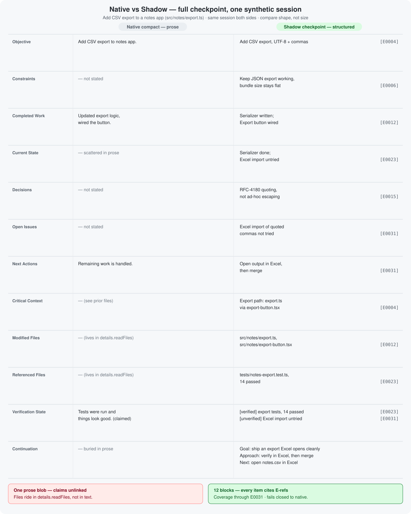

# Claude Shadow Compact

A Claude Code **mod** (plugin of function hooks) that ports
[pi-shadow-compact](https://github.com/sij0sh/pi-shadow-compact) to
Claude Code. It is a real compactor, not a hooks-plus-context shim:
when compaction fires, Shadow answers with a **verified structured
checkpoint plus the exact recent tail** (original messages carried by
their engine handles, untouched), instead of Claude's native summary.

## Native vs Shadow

Native compaction writes a prose summary of what it saw. Shadow writes a
checked checkpoint: every claim points at saved session entries, tested work
is marked verified, untested work stays unverified, and the checkpoint names
exactly how far it covers. A second agent checks the first. If the check
fails, the session falls back to native compaction.

The example is synthetic and shows the same session on each side, so
compare shape, not size. Task and paths are generic on purpose.

<div align="center">



</div>

| Area | Native | Shadow |
|---|---|---|
| Grounding | Prose, no links | Each claim cites entries (`E0004` ...) |
| Tested vs untested | Same voice | `[verified]` vs `[unverified]` ledger |
| Resume pointer | Buried in prose | Goal, approach, next step |
| Coverage proof | None | `coverageEndEntryId` in live transcript |
| Failure mode | Always installs prose | Falls back to native when unsafe |

<details>
<summary>Text version of the example</summary>

Synthetic session — add CSV export (`src/notes/export.ts`). Left column:
what native prose provides per area. Right column: the Shadow checkpoint.

```text
Native: "Add CSV export to notes app. Updated export logic and wired
the button. Tests were run and things look good. Remaining work
is handled. See prior files for details."

Shadow:
## Objective
- Add CSV export, UTF-8 + commas [E0004]
## Constraints
- Keep JSON export working; bundle size stays flat [E0006]
## Completed Work
- Serializer written; Export button wired [E0012]
## Current State
- Serializer done; Excel import untried [E0023]
## Decisions
- RFC-4180 quoting, not ad-hoc escaping [E0015]
## Open Issues
- Excel import of quoted commas not tried [E0031]
## Next Actions
- Open output in Excel, then merge [E0031]
## Critical Context
- Export path: export.ts via export-button.tsx [E0004]
## Modified Files
- src/notes/export.ts, src/notes/export-button.tsx [E0012]
## Referenced Files
- tests/notes-export.test.ts, 14 passed [E0023]
## Verification State
- [verified] export tests, 14 passed [E0023]
- [unverified] Excel import not tried [E0031]
## Continuation
- Goal: ship an export Excel opens cleanly
- Approach: verify in Excel, then merge
- Next: open notes.csv in Excel
Coverage through E0031. Builder + verifier; fails closed to native.
```
</details>

## How it works

```text
session.append ──► durable evidence archive (sanitized, stable evidence ids)
session.measure ≥150k tokens ──► private builder agent (Read/Grep on the archive)
                      ──► private verifier agent (independent re-read)
                      ──► validated checkpoint published (in memory)
Claude's /compact or auto-compaction ──► session.compact hook
                      ──► [checkpoint message] + [exact tail by handle]
no/unproven checkpoint ──► next(e): Claude native compaction (fail closed)
```

- **Evidence archive.** Every main-loop `session.append` row is mirrored
  in append order under its stable Claude uuid, sanitized (secret
  redaction fails closed on any key whose name merely contains a secret
  keyword), and served to the side agents as paged JSONL. Later
  checkpoints re-ground on original evidence, never recursively on the
  last summary. Sessions that predate installation bootstrap from
  `$.session.messages()`.
- **Builder → verifier.** Two private agent types
  (`shadow-compact:checkpoint-builder` / `checkpoint-verifier`) are
  registered Read/Grep-only, Claude-MD-free, and hidden from the acting
  model via `agent.offer`. They return strict JSON; the mod validates
  schema, evidence citations, coverage boundary, and continuation state,
  retrying with the validation error fed back. If agent spawning fails,
  preparation retries through `$.model.complete` with inlined evidence.
  That fallback refuses evidence over its 120,000-character limit rather
  than silently truncating it.
  An `unusable` verifier verdict fails closed.
- **Compaction.** Shadow never starts a compaction itself: Claude Code
  runs a plugin's own `$.session.compact()` through every hook except
  the caller's, so a self-started compaction would skip Shadow's
  replacement. Claude Code's `/compact` and auto-compaction are the
  install points. The `session.compact` hook proves coverage by
  identity: the checkpoint's coverage row uuid must sit in the live
  transcript, never an index counted from append events. Attachments and
  canceled rows cannot shift the boundary. A host that clones retained
  UUIDs is supported only when the entire returned prefix still matches,
  including tool arguments and results. The tail starts at the round
  holding the first uncovered message, keeping at least `recentTurns`
  rounds (a round is a prompt with its reply, or one assistant response
  with its tool results, so a long single-prompt agentic turn can still
  compact); no tool result is orphaned from its call, and the candidate
  must actually shrink the context. `precompute` compactions are skipped.
- **Checkpoint-first gate.** A checkpoint that is still preparing is not
  a failed one. When Claude Code compacts before the checkpoint is ready,
  Shadow holds that compaction for up to `compactWaitSeconds` (120 by
  default) while the in-flight preparation finishes, then installs it;
  when nothing is preparing it starts one just-in-time attempt and waits
  on that. The wait runs as a chain of one-second host `sleep` processes
  (or Node, where `sleep` is missing), because a hook's 10-second budget
  pauses during host calls but not during `$.clock` waits. Native
  compaction runs only when the wait times out, the preparation fails,
  coverage still cannot be proven, or a failed preparation has not been
  re-armed (failures are never retried at compaction). A preparation that
  finishes after a compaction removed its covered row is discarded
  instead of published. `lastCompact` records the wait, e.g.
  `waited=48s:done`. Set `compactWaitSeconds` to `0` for the old
  immediate native fallback.
- **Preparation deadline.** `prepareTimeoutSeconds` (360 by default,
  at most 600) is one deadline across both roles, retries, and every
  backend fallback. Native compaction cancels preparation when its covered
  row is removed: Pi aborts its provider request through a cancellation
  marker; owned Claude agents receive `TaskStop`. An already-running
  `model.complete` call has no explicit abort API, but its late answer is
  ignored and no further calls start. The compaction hold remains separately
  bounded by `compactWaitSeconds`.
- **Install confirmation.** Returning the checkpoint is an attempt, not
  an install. It counts once canonical history (`$.session.messages()`)
  opens with that checkpoint's coverage line; `/shadow-status` shows
  `phase=installing` until then and `lastCompact` records every decision.
- **Thresholds.** Background checkpoint preparation starts at 150,000
  context tokens (absolute, independent of the context window). On each
  model's first session Shadow sets Claude Code's auto-compact window to
  190,000 through `/autocompact` (it applies at once and is saved under
  `modelSettings` in your user settings). The observed Opus compaction
  trigger is around 157–162k for that window, so the bounded hold can be
  needed to finish preparation. Shadow leaves the window
  alone when one is already chosen: `CLAUDE_CODE_AUTO_COMPACT_WINDOW`, a
  settings `autoCompactWindow` (including `auto`), or managed settings.
  It decides once per model and remembers that, so a later
  `/autocompact` of yours is never overwritten; `/shadow-status` shows
  the outcome as `autoCompactWindow=`.
- **Idle compaction.** Claude Code (2.1.290+) compacts a long conversation
  that has sat idle for about 54 minutes, just before its one-hour prompt
  cache expires, as an ordinary `auto` compaction that Shadow intercepts.
  Its floor is 200,000 tokens; Shadow lowers it to 100,000 (the lowest
  Claude Code accepts) by setting `CLAUDE_CODE_IDLE_COMPACT_MIN_TOKENS` for
  the session, unless you already set that variable or turned idle
  compaction off with `"idleCompaction": false`. When a turn completes
  between that floor and the checkpoint threshold, Shadow prepares a
  checkpoint so it is ready before the idle compaction fires; reaching the
  checkpoint threshold later refreshes it once. Idle compaction itself is
  rolled out by Claude Code and needs an interactive session with the
  one-hour cache; `/shadow-status` shows the floor outcome as
  `idleCompact=`. A failed preparation is not retried
  until the next compaction or a manual `/shadow-compact`. Rolling refresh
  re-arms after a Shadow install followed by below-checkpoint context, or
  after native compaction.
- **State.** The checkpoint and transcript index live in memory for the
  session. After a restart or resume, Shadow re-prepares rather than
  trusting a checkpoint it cannot prove against the live transcript. The
  evidence snapshot for the side agents is a file under the plugin's
  `.shadow-data/<session-id>/prepare-<runtime-id>-<generation>/` directory.
  Evidence, each worker call's result, the checkpoint and outcome are kept
  separately per attempt. Diagnostic JSON files under
  `.shadow-data/<session-id>/events/` persist compact eligibility, wait
  start/end, native reasons, cancellation and confirmed installs; they
  contain metadata rather than prompts. `/shadow-status` names that path,
  and a native fallback prints its reason.

## Install

/plugin install shadow-compact --marketplace sij0sh/claude-shadow-compact

Or, from a local checkout, load it for one session with
`claude --plugin-dir /path/to/claude-shadow-compact`.

## Commands

| Command | Behavior |
|---|---|
| `/shadow-compact` | Start background preparation now (honest when history is too short); run `/compact` to install a ready checkpoint |
| `/compact-native` | Run Claude Code native compaction once, bypassing Shadow |
| `/shadow-status` | Version, phase, archive size, checkpoint coverage, installs, threshold, auto-compact window and idle-compaction outcomes, per-role backend, Pi check and usage, last preparation, last fallback, last compaction decision |
| `/shadow-export` | Print the verified checkpoint for manual copy-paste |

## Configuration

Set via the plugin's `userConfig` (Claude Code `/config` or
`pluginConfigs`):

| Setting | Default | Behavior |
|---|---|---|
| `prepareThresholdTokens` | `150000` | Start background checkpoint preparation |
| `configureAutoCompactWindow` | `true` | Set Claude Code's auto-compact window once per model unless one is already chosen |
| `autoCompactWindowTokens` | `190000` | The window Shadow sets; must exceed `prepareThresholdTokens` and be below the model's context window |
| `configureIdleCompaction` | `true` | Lower Claude Code's idle-compaction floor and prepare at a completed turn above it |
| `idleCompactMinTokens` | `100000` | Idle-compaction floor; values under 100,000 use 100,000 |
| `recentTurns` | `10` | Minimum recent rounds kept verbatim (prompt + reply, or assistant response + its tool results) |
| `compactWaitSeconds` | `120` | How long a compaction waits for a preparing checkpoint before native fallback; `0` never waits, at most `600` |
| `prepareTimeoutSeconds` | `360` | Overall preparation deadline across roles, retries and backend fallbacks; positive integer, at most `600` |
| `builderModel` / `verifierModel` | `haiku` | Checkpoint agent models; `inherit` uses the session model |
| `manualCompactMode` | `shadow` | `shadow` or `native` for manual `/compact` |
| `builderBackend` / `verifierBackend` | `claude` | `claude` or `pi` per role (see [Optional Pi backend](#optional-pi-backend)) |
| `piBuilderProvider` / `piBuilderModel` | `""` | Pi provider and model id for a `pi` builder |
| `piVerifierProvider` / `piVerifierModel` | `""` | Pi provider and model id for a `pi` verifier |
| `piBuilderThinking` / `piVerifierThinking` | `low` | Pi thinking level per role (`off` … `max`), clamped to what the model supports |
| `piNodePath` | `node` | Node.js executable that runs the Pi worker |

Token settings must be positive safe integers; invalid values use the
default. The former `hardThresholdTokens` setting is gone (Shadow now sets
Claude Code's `autoCompactWindow`), as are the older percentage settings.

Builder and verifier run as private Claude agents with file access to the paged evidence archive. When agents are unavailable the pipeline retries with `model.complete` on inline evidence, then fails closed to native compaction. Agent spawn failures are logged at debug level without prompt contents, and `/shadow-status` shows the resolved model per role plus the last fallback reason.

## Optional Pi backend

Either role can run through the [Pi SDK](https://github.com/earendil-works/pi)
instead of a Claude agent. Claude is the default, and Pi is used only when
you set it on purpose. You can mix them, e.g. a Pi builder with a Claude verifier.

**Privacy:** a Pi role sends the sanitized evidence archive (and the
previous checkpoint) to the provider you configure. That provider is outside Claude Code.

Setup:

1. Install Pi and run `pi`, then `/login` for the provider you want. The
   worker uses Pi's stored credentials and model catalog.
2. Set `builderBackend` and/or `verifierBackend` to `pi`, plus that role's
   `pi*Provider` / `pi*Model` (and optionally `pi*Thinking`). Node.js 20+ must be on `PATH`, or set `piNodePath`.

How it runs:

- Hooks have no Node, so each role answer is its own bounded
  `$.process.run` of the bundled worker `dist/pi-checkpoint-worker.mjs`, capped at
  10 minutes and by the preparation's remaining deadline. Builder and verifier are separate calls.
- The worker runs Pi's tool-calling checkpoint loop over a frozen
  snapshot of the evidence. Its only tools are evidence reads
  (manifest, turns, rows, search, previous checkpoint) and submit. It has no
  shell, edit, write, or repository reads. Each agent can cite only rows
  it was actually served, and it has to read the required turns before submitting.
- The answer is written atomically to a result file tagged with a
  per-call nonce in its filename and content. Stdout carries only a one-line status. Shadow then
  validates the answer exactly as it does a Claude agent's.
- At session start Shadow runs a check that confirms each model exists and
  has credentials. This check makes no inference call.
- **Fallback:** if Pi fails at any point, Shadow redoes the whole
  preparation with the Claude models. Pi failures include a bad check, a worker crash, a provider error,
  a rejected answer, or an `unusable` verdict. A worker that cannot run or
  start is not launched again that session.

`/shadow-status` shows `builder=` / `verifier=` per backend, `pi=` (check
state), `piUsage` (calls, failures, tokens, cost) and `lastPrepare`
(backend and duration); `lastFallback` records the chain, e.g.
`pi:... then agents:...`.

## Managed installs and updates

On organization-managed Claude Code, `session.compact` hooks run only for
org-listed plugins. If yours is not listed, Shadow prepares but never
installs: `/shadow-status` shows `lastCompact=unseen` after a compaction. Ask the org to
allowlist `shadow-compact`, or copy `/shadow-export` output by hand.

If the marketplace reports a stale version after a release, refresh it:

```bash
claude plugin marketplace update claude-shadow-compact
claude plugin update shadow-compact@claude-shadow-compact
```

`/shadow-status` shows the running version (`v0.4.6`).

## Deferred from the Pi version

- **Request-local mid-turn swaps.** Pi rewrites an individual model
  request without touching canonical history; Claude pins the
  transcript in `turn.step`, so Shadow installs canonically through
  `session.compact` when Claude Code compacts. A very long single turn
  cannot be swapped halfway through.
- **Native-summarizer token-cap recovery.** Claude's compact result
  exposes no stable truncation signal, so the v1 policy is simply:
  Shadow ready → Shadow compaction; otherwise native.

## Develop

```bash
npm install
npm run check   # typecheck, claude plugin validate ., claude plugin test ., worker tests
npm run build   # rebuild dist/pi-checkpoint-worker.mjs after changing worker/ or hooks/pi-protocol.ts
```

The Pi worker bundle in `dist/` is committed so installs need no build
step; `npm run test:worker` runs the worker's agent-loop tests under Node.

`.claude/types/claude-code.d.ts` is the generated mod API declaration
(written by Claude Code 2.1.277); regenerate it with `/plugin-types`
after a Claude Code update rather than editing it.
