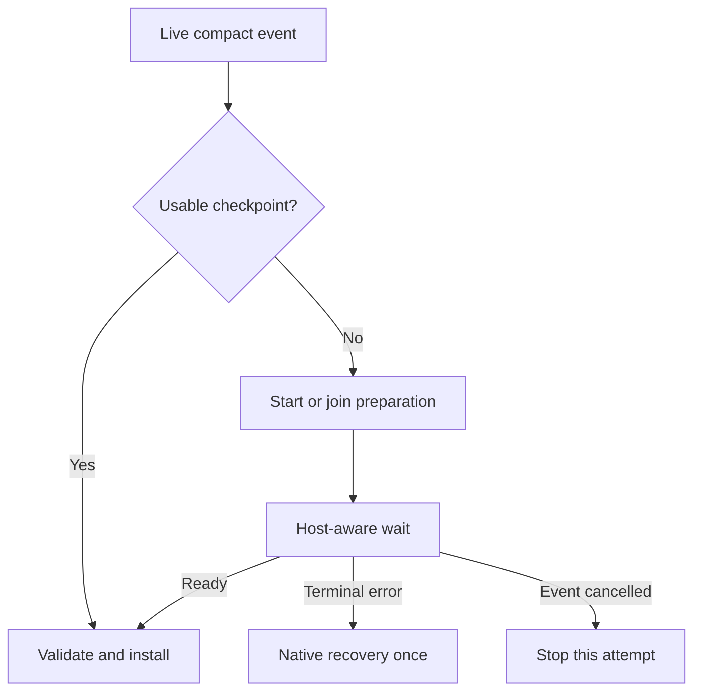

# Shadow Compact: faster curation and reliable compaction waiting

Implementation plan following the reported 0.4.11 failures  
Date: 2026-10-19  
Scope: analysis and proposed implementation only. No extension or Claude settings changes are included.

## 1. Recommended design

Keep **two independent, narrowly scoped model calls**, one execution path, and one compaction gate:

1. Code assembles a bounded evidence packet.
2. A curator produces a short continuation checkpoint.
3. Code validates its structure and evidence references.
4. An independent verifier checks the checkpoint against source evidence and returns a small verdict.
5. The compaction hook installs an eligible checkpoint immediately, or holds the event while preparation finishes.

**Native summarization becomes an explicit recovery action after a terminal failure.** A missing checkpoint, an earlier failed attempt, or healthy work taking longer than expected does not authorize it.

I interpret the requested “native compact only after an error” as referring to Claude's native summarizer. Normal compaction events should still happen proactively, before a context-limit API error, so Shadow can replace the context safely.

Preserve the three public settings: checkpoint model `haiku`, effort `high`, and checkpoint threshold `160000`. Keep idle preparation at `100000` internally. Add no new configuration controls.

### 1.1 The highest-value changes

| Priority | Change | Result |
| --- | --- | --- |
| P0 | Remove the failed-preparation latch from scheduling | One failure cannot disable preparation for the rest of a session |
| P0 | Make the live compact path start or join preparation unconditionally when needed | Early host triggers and missed background preparation remain recoverable |
| P0 | Implement a host-aware wait before calling `next` | Slow, healthy preparation cannot silently release native summarization |
| P0 | Apply and verify an effective window override above the saved 190k value | The 160k preparation threshold gets useful lead time |
| P1 | Replace broad builder/verifier agent work with bounded model requests | Less input, output, tool use, and orchestration |
| P1 | Use one evidence representation and one model executor | Remove the worker-to-inline fallback size trap and duplicated transport logic |

## 2. What the trace establishes

This plan uses the supplied logs and prior conversation. The 0.4.11 source archive is not available in this workspace, so named functions and files below are implementation targets to confirm against the actual release.

| Observation | Interpretation | Required correction |
| --- | --- | --- |
| Briefcase entered compaction without a checkpoint or running preparation; `refreshArmed` remained false after failure | Scheduling retained an obsolete failure gate | Failure must clear active work and establish explicit retry eligibility |
| Compaction occurred below the configured 160k preparation threshold | A live compaction request must be sufficient reason to prepare | The live gate bypasses background token thresholds |
| The verifier was cancelled near the shared preparation deadline | The builder consumed most of a combined budget | Remove the shared 360-second builder-plus-verifier deadline |
| Inline fallback refused the evidence payload | A nominal recovery path could not handle these inputs | Bound the primary evidence packet and remove the incompatible transport switch |
| The saved model window remained at 190k | Preserving that value defeated the intended scheduling policy | Shadow's active-session window policy must take precedence |
| Enactry waited, then fell back after approximately 356 seconds | Waiting cannot fix a preparation job that is being cancelled underneath it | Separate preparation failure policy from the compaction wait |

Two precision points matter. The elapsed times are consistent with deadline exhaustion; they do not establish how long an unrestricted verifier would have needed. Also, evidence bytes, JavaScript characters, and model tokens are different measures. The explicit inline-limit error establishes refusal for these attempts; byte size alone is not a universal eligibility test.

## 3. Simplify the model workflow

### 3.1 Prefer bounded, tool-free host model calls

Use `$.model.complete` as the intended sole model transport for both roles. It supports a selected model and effort without exposing the full live session. The official API describes it as a separate request without tools; `$.model.fork` inherits the session model and conversation, so it is a poor fit for a configurable Haiku curator. [Source: mods API][source-api]

First prove, on the supported Claude Code build, that this path supports the required input budget, effort, cancellation behavior, and background completion while compaction is held. If that probe fails, retain the existing isolated executor as the sole transport for this release. Make that decision once during implementation; do not ship another runtime backend/fallback matrix.

After the host path passes, remove model-worker launch/discovery, recursive agent activity, and worker-to-inline transport fallback. A small process helper may still be needed solely for host-aware waiting, as described in section 5.

Both roles use one `executeCheckpointRole` function with role-specific prompts and output limits. It owns result normalization, model/effort application, cancellation, request errors, and the bounded transport retry. Keep host API calls statically visible to Claude's plugin validator.

### 3.2 Give the curator a continuation task

The curator writes only what another assistant needs to continue:

| Checkpoint field | Preserve |
| --- | --- |
| Goal and constraints | Current user intent, corrections, explicit prohibitions, acceptance criteria |
| Current state | What changed, what remains unfinished, decisions still in force |
| Evidence | Exact commands, important paths/identifiers, decisive errors and results, with source references |
| Verification | Checks actually performed, their outcomes, and unresolved uncertainty |
| Next actions | The immediate next steps and blockers |

Exclude historical narration, repeated plans, obsolete approaches, duplicate logs, and explanations already recoverable from current files. Preserve a rationale only when it affects the next decision. Do not run tools, re-test the project, or independently investigate the repository during curation.

### 3.3 Give the verifier an audit task

The verifier receives the candidate plus independently selected source material. Its task is to identify:

- Lost user requirements or corrections.
- Unsupported completion claims or changes in certainty.
- Incorrect paths, commands, identifiers, or decisive results.
- Missing blockers or next actions that affect continuation.

Return a fixed verdict such as `{ pass, issues }`, with issues identifying checkpoint fields and source references. Do not ask the verifier to write a second full checkpoint. Publish only after an independent pass and deterministic validation.

The normal path uses two calls. Allow one retry of an affected role for a retryable transport failure, retaining a valid curator draft when verification must retry. A quality rejection is terminal for that candidate; do not turn it into a pass through repeated regeneration or transport changes.

### 3.4 Alternatives to leave out

| Alternative | Assessment |
| --- | --- |
| One model call with a self-check | Lowest latency, but loses independent verification; defer unless continuation evaluations justify that tradeoff |
| Two full transcript summaries | Duplicates expensive reading and generation; replace with curation plus an audit |
| Parallel builder and final verifier | The verifier needs the completed candidate; parallel execution does not remove that dependency |
| Sharded summaries, vector search, or an agent team | Additional coordination and failure modes without evidence they are needed |
| Warm forks or persistent curator agents | Revisit only if the bounded two-call design misses measured performance targets |

## 4. Apply the 20/80 rule to evidence

### 4.1 Preserve the archive; reduce what models must process

Keep the evidence archive and coverage proof. Build one deterministic projection from it, shared by preparation, retries, and verification. Preserve source row IDs and full-source digests even when the model sees a selected excerpt.

Prioritize current user instructions, unresolved decisions, actionable state, and decisive outputs. Deduplicate repeated logs. For large outputs, select bounded error/result excerpts with surrounding context. Keep exact literals when they matter. Retain references to omitted, recoverable material.

Where an accepted checkpoint already exists, carry forward its still-relevant content and process new evidence since its boundary. Keep its grounding references available. Avoid a new incremental-memory subsystem or unrestricted chains of summaries.

### 4.2 Initial internal budgets

These are proposed starting limits to evaluate, not measured performance claims:

| Item | Initial limit |
| --- | --- |
| Curator request, including instructions | 24k input tokens |
| Curator answer | 4k output tokens |
| Verifier request, including candidate and sources | 12k input tokens |
| Verifier answer | 1k output tokens |

Use a supported token counter where available, plus a conservative payload-size check. A character or byte guard protects transport size; it does not substitute for model-context accounting. Include output headroom.

Treat user instructions and retained checkpoint obligations as protected material. If protected material exceeds the packet budget, move the coverage boundary earlier and keep the remaining messages verbatim. If that cannot produce a useful, safe replacement within the host budget, return an explicit `evidence_budget_exceeded` error. Never silently chop evidence and claim complete semantic coverage.

### 4.3 Prevent the verifier from inheriting selection blind spots

Assemble its source packet in code from the covered user instructions, prior retained obligations, candidate citations, and decisive output rows. Do not let curator-selected citations be its only evidence. Check requirement coverage as well as individual claims.

Apply the protected-material rule to the verifier's budget too. If the necessary audit evidence cannot fit, reduce coverage and retain the remainder, or fail explicitly. Do not approve a candidate after quietly omitting its required audit sources.

Source IDs prove references exist; prefix digests prove transcript identity. Neither proves that every important meaning survived. Evaluate semantic omissions using continuation tasks before accepting the smaller packets.

Retain the existing original-message tail, including all uncovered messages and complete tool-call/result groups. Before installing, check the size of the checkpoint plus the entire required tail. A valid older checkpoint is usable only when that replacement still fits and leaves useful headroom.

## 5. Make compaction waiting independent and reliable

### 5.1 One decision owner

The live `session.compact` handler decides between installation and native recovery. Background preparation never calls native compaction as a failure side effect.

On entry, reconcile history where needed and install a proven checkpoint immediately when available. Otherwise start or join preparation, even below 160k and regardless of a previous background failure latch. `no-checkpoint` is a state to resolve, not a recovery error.

Keep speculative `precompute` events separate: skip native precomputation using the supported result shape. Apply the live gate to automatic, idle, manual, and plugin-triggered compactions; leave subagent handling consistent with the existing scope. Preserve explicit manual compaction instructions when deciding whether an already prepared checkpoint is suitable.

After readiness, recompute eligibility against the actual compaction input, validate the prefix and tail, and return the replacement without calling `next`. Keep original message handles and installation confirmation. Never mark an attempted return as a confirmed installation.

### 5.2 Respect the host's hook budget

This is a release-critical constraint. Current official mod documentation gives a hook 10 seconds of its own execution time. Time inside most mods API calls is excluded; `$.clock.sleep` is an exception. An ordinary promise wait can consume the hook budget. `$.process.run` has a default 30-second timeout and a maximum of 10 minutes. [Source: mod limits][source-reference]

Therefore, simply awaiting a shared preparation promise, adding sleeps, or increasing Shadow's own timeout does not establish a reliable hold.

Use a budget-exempt host operation for the blocking wait. Prefer reusing an existing process wait mechanism. Otherwise add one small waiter that watches an atomic outcome record for the exact session epoch and preparation generation. Invoke it through `$.process.run` with an explicit timeout, for example a 240-second lease.

When a lease expires and the generation is still healthy, renew the wait. Lease expiry does not fail preparation, restart a role, or release native summarization. The helper performs no model work. Keep the preparation job progressing independently while the helper waits, and prove that this does not deadlock the host.

Use documented cancellation signals. A helper exit or missing outcome must resolve to a typed error or continued wait according to the job's actual state. Prevent missing-file polling and dead workers from holding forever.

Attach the hook's supported `.catch` handler. Mod hooks can otherwise be skipped on errors or timeout, allowing the chain to continue. Keep this handler minimal and ensure native delegation occurs at most once. [Source: hook failure behavior][source-events]

### 5.3 Define the boundary between waiting and failure

Remove the aggregate 360-second preparation deadline and the separate compact-wait countdown. Each model request keeps its own explicit request limit. Start with 600 seconds per role, subject to the supported host API; confirm abort and late-result behavior in the initial probe.

This remains a real elapsed-time limit, not proof that a request is stalled. Log it as `role_deadline_exceeded`, with the role and duration. It is intentionally separate from the wait leases and should be revisited using measured latency. Healthy work crossing 360 seconds in total must continue. A verifier must not inherit the curator's nearly exhausted allowance.

Prefer transport-reported stream failures or verified worker failure over a new heuristic stall timer. A live PID or generic heartbeat alone does not prove model progress. Do not let periodic file updates renew request limits indefinitely.

| Outcome | Gate behavior |
| --- | --- |
| Ready, including a retained older checkpoint that still fits | Validate and install |
| Running, slow, or wait lease expired | Continue holding |
| Retryable transport error | Perform the bounded role retry; keep holding |
| Exhausted transport retry, role deadline, rejected checkpoint, or unrepairable history | Record the exact terminal error; use native recovery once |
| User interruption or abandoned event | Stop this compaction attempt; do not launch native summarization |
| Unsupported or externally blocked hook | Report degraded operation; do not claim the gate is protecting the session |

Do not replace this mechanism with repeatedly blocking `PreCompact` and letting conversation growth continue. Official documentation notes that blocking recovery compaction after a context-limit error can fail the current request. [Source: PreCompact][source-hooks]

## 6. Remove the permanent failure gate

### 6.1 Minimal state

Keep one published checkpoint and one active preparation job. Put the role phase on the job. Store the last outcome and retry time separately. Preserve session/history epochs, generation IDs, digests, and attempted-versus-confirmed installation metadata.

On failure, clear the active job and retain any valid published checkpoint. On successful refresh, atomically replace the published checkpoint. A failed refresh must not destroy the earlier checkpoint.

Replace `refreshArmed` as an attempt permission latch with explicit scheduling rules. Background threshold and idle triggers, retry scheduling, and live compaction all use the same start-or-join operation. Atomically claim a job before any asynchronous work so concurrent events cannot launch duplicates.

### 6.2 Bounded automatic recovery

Use an internal 60-second cooldown and one automatic retry for retryable errors on the same frozen evidence/configuration. Schedule it through the existing host timer so another user action is unnecessary. Reuse a valid draft when only verification failed.

After that budget is exhausted, permit a new background attempt when a completed turn supplies materially new coverage or the model configuration changes. Do not treat every appended block as a new retry budget.

A live compaction may bypass background thresholds and cooldown to start one eligible attempt. It must not repeatedly retry a known terminal rejection against identical evidence. Never return successfully from `runPreparation` without either joining/creating a job or recording an explicit reason no attempt is eligible.

## 7. Override the saved 190k window effectively

### 7.1 Active-session policy

The earlier recommendation to preserve any explicit user window was too conservative for the requested automatic behavior. While Shadow is enabled, its compaction policy should take precedence over the saved `modelSettings.claude-opus-5-5.autoCompactWindow: 190000` value.

Claude documents `CLAUDE_CODE_AUTO_COMPACT_WINDOW` as taking precedence over saved windows and the CLI window flag. Top-level `autoCompactWindow` does not beat a model-specific window in the same settings file. Windows remain capped by the effective model context capacity. [Source: model configuration][source-model]

Use a scoped environment override as the preferred mechanism. Prove that setting it through the plugin affects the running host before advertising immediate application; reading back the environment alone is insufficient. If the host reads it only at startup, use a supported runtime setter or require that capability in the minimum supported build. Do not silently claim success after writing an ineffective value.

### 7.2 Initial window policy

Use `min(effectiveModelCapacity, max(240000, checkpointThreshold + 80000))` as the initial internal window policy. With the default threshold, this proposes a 240k window when the provider and host support it. It is a starting point for live testing, not a guarantee that native compaction triggers at 200k.

The reported 190k setting produced a native boundary around 159k. Raising the window supplies lead time on larger-context models, but the relationship is host-dependent. Do not learn a multiplier from the difference between Shadow's measurements and Claude's boundary accounting. Log both measures separately.

For an effective 200k model, use the latest supported safe window and rely on the gate if native compaction arrives earlier. Never inflate the advertised model capacity to delay compaction. If a user selects a checkpoint threshold beyond the effective safe trigger, prepare at the latest safe point and report the effective threshold.

Preserve idle preparation at 100k and the host's idle-compaction path. The idle floor makes a session eligible; it does not guarantee an idle event. [Source: idle floor][source-env]

### 7.3 Application and ownership

Reapply the policy at session start/reload and model changes, including resumed-session initialization. Record requested window, effective window, source, model, and any cap or block.

Prefer a session-scoped override so saved user settings can remain intact beneath it. Track the prior value and restore only if the current value is still Shadow's. If persistence is necessary, merge only the necessary keys, retain their original values, and restore conditionally. Do not rewrite whole settings files or create a configuration write loop.

Test the exact supplied per-model 190k setting. Remove the `kept-settings`/`decided-before` early return that prevents the active policy from taking effect. If host controls prevent an override, surface that limitation in concise status and still exercise the live gate at the actual trigger.

## 8. Implementation sequence

| Step | Work | Completion criterion |
| --- | --- | --- |
| 0. Establish host contracts | Inspect the installed build's generated declarations; probe replacement messages, model calls, window application, cancellation, and budget-exempt waiting | Supported build and effective behavior documented; no inference from mocks alone |
| 1. Fix recovery scheduling | Update `hooks/state.ts` and `hooks/register.ts`; remove permanent latch behavior; add one start-or-join path | Briefcase reproduction starts or joins preparation below 160k after an earlier failure |
| 2. Fix the live gate | Centralize native delegation; add generation-aware host waiting and atomic outcomes; remove aggregate timeout | A healthy preparation lasting beyond 360 seconds finishes without native summarization starting |
| 3. Apply window policy | Replace preservation-only window handling; verify actual host application | Supplied 190k setting no longer controls Shadow-enabled supported sessions |
| 4. Narrow curation and verification | Add bounded shared evidence projection, focused prompts, compact verdict, role-level retry | Representative continuation quality is maintained with substantially less model work |
| 5. Cut obsolete execution | After the host transport passes, remove model-worker orchestration and inline fallback branches | One shipped model transport, one role executor, no 120k fallback cliff |
| 6. Validate and package | Run regression checks and genuine Claude sessions; rebuild only remaining runtime assets | Release evidence includes slow holds, safe swaps, settings precedence, and measured quality/latency |

Reuse existing modules wherever their responsibilities already fit. Keep orchestration, evidence projection, and pure installation validation distinct. Avoid a broad state-machine rewrite beyond what these failure fixes require.

Official guidance says the generated `.claude-plugin/types/claude-code/index.d.ts` reflects the installed build and should take precedence over potentially older public declarations. Verify the replacement-message contract there before implementation. [Source: build-specific types][source-types]

## 9. Acceptance tests and release gates

### 9.1 Reproduce the reported failures

1. Failed idle preparation, no checkpoint, below 160k, later automatic compact: start/join an eligible attempt and hold; no immediate `native(no-checkpoint)`.
2. Curator takes 262 seconds and verifier takes another 191 seconds successfully: publish and install after 453 seconds; no inherited 360-second deadline.
3. Unreconciled history, then successful repair: follow the same gate as normal compaction.
4. Evidence fixtures of 138083 and 228254 bytes, plus multibyte text: use explicit budgets; no size-incompatible transport fallback or silent truncation.
5. User settings contain the supplied model-specific 190k window: verify the actual effective override in a live host.

### 9.2 Verify lifecycle and integrity

- Ready checkpoint swaps with zero new model calls; target local preparation-to-return overhead below 250 ms on representative hardware.
- A multi-minute wait crosses multiple leases without a skipped hook or native model request. Confirm this in the real host, beyond its ordinary hook budget.
- Concurrent measure, append, completed-turn, idle, and compact events produce one active preparation.
- Refresh failure preserves an eligible older checkpoint; an oversized tail prevents installation even when its prefix proof is valid.
- Verifier transport failure retries verification without rerunning a successful curator.
- Quality rejection, exhausted request failure, and unrecoverable history yield explicit native recovery exactly once.
- Cancellation, reload, resume, and stale-generation completion cannot install into another history epoch or start native work after abandonment.
- Tail preservation retains parallel tool calls and results together, long turns, corrections, and opaque blocks supported by the existing implementation.
- A 100k idle checkpoint can refresh at 160k without making the older checkpoint unavailable. Hosts without eligible idle compaction remain correct on the automatic path.
- Window caps, changed models, conflicting settings, and unavailable capabilities produce truthful status.

### 9.3 Measure quality and speed together

Compare the current pipeline and proposed bounded pipeline on the same representative transcripts, including both reported size cases. Include requirements from early turns, later corrections, unfinished changes, failing tests, and exact error strings.

Evaluate whether an assistant continuing from the checkpoint plus tail follows the current instructions, knows what was actually verified, and takes the correct next action. Require zero critical omissions or false completion claims in the release fixture set. This is a release criterion, not a claim of universal accuracy.

Initial performance targets: median preparation below 60 seconds and p95 below 120 seconds on the supported default model and representative sessions. Report measured results and provider variability; do not enforce those targets as fallback timers.

Record only the diagnostics needed to explain an outcome: trigger and separate token readings; window source/effective value; evidence/input/output sizes; generation and role timings; retry reason; gate wait and terminal error; attempted and confirmed install. Keep status short, with a clear indication when automatic interception is degraded.

Do not label the release seamless until live tests prove the effective window override, a hold beyond the host's normal hook budget, and a ready replacement that bypasses native summarization.

## 10. Source references

The session timings, function names, failure sequence, and saved setting above come from the user-provided trace. Host behavior was checked against these primary sources on 2026-10-19; exact installed-build behavior remains an implementation gate.

- [Claude Code model configuration][source-model]: auto-compaction controls, precedence, and context caps.
- [Claude Code environment variables][source-env]: window and idle-floor controls.
- [Claude Code mods API][source-api]: standalone model requests, background work, and host operations.
- [Claude Code mod limits][source-reference]: hook execution budgets and process-call limits.
- [Claude Code mod event handling][source-events]: middleware behavior and failure handlers.
- [Claude Code hooks reference][source-hooks]: effects of blocking ordinary PreCompact hooks.
- [Claude Code build-specific declarations][source-types]: obtaining the installed host's types.

[source-model]: https://code.claude.com/docs/en/model-config#context-window-and-auto-compaction
[source-env]: https://code.claude.com/docs/en/env-vars
[source-api]: https://code.claude.com/docs/en/plugins/mods/api
[source-reference]: https://code.claude.com/docs/en/plugins/mods/reference#limits
[source-events]: https://code.claude.com/docs/en/plugins/mods/events#handle-a-hook-that-fails
[source-hooks]: https://code.claude.com/docs/en/hooks#precompact
[source-types]: https://code.claude.com/docs/en/plugins/mods/create#get-type-definitions-for-your-version
